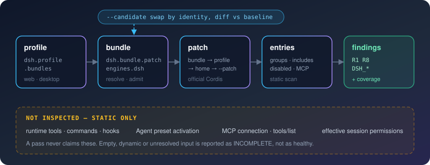
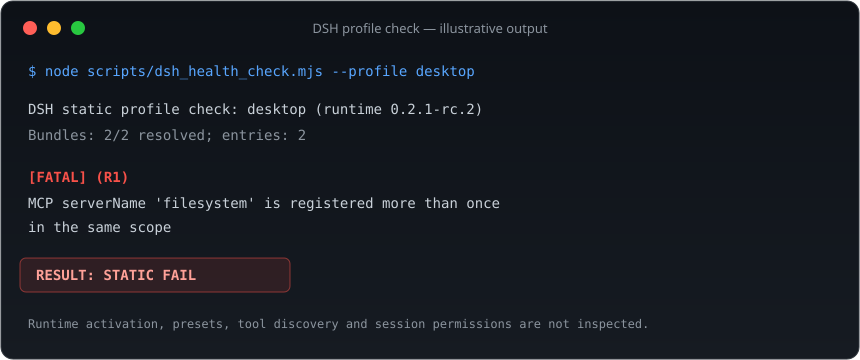

<p align="center">
  
</p>

<p align="center">
  <strong>Dry-run your DSH plugins before you install them.</strong><br>
  Read-only and static: it composes your real profile with the official algorithm, then tells you what will break.
</p>

<p align="center">
  <a href="#install">Install</a> ·
  <a href="#how-it-works">How it works</a> ·
  <a href="#sample-output">Sample output</a> ·
  <a href="#dry-run-before-installing">Dry run</a> ·
  <a href="#limits">Limits</a> ·
  <a href="docs/dsh.md">Reference</a> ·
  <a href="README.md">中文</a>
</p>

<p align="center">
  <a href="https://github.com/GlariaLuminous/dsh-plugin-health-check/actions/workflows/ci.yml"></a>
  
  
  
  <a href="LICENSE"></a>
</p>

---

A DSH plugin does not work just because it sits in `node_modules`. Whether it loads depends on which bundles the profile selects, how patches override each other, and whether the package's declared versions are admitted by DSH. Most of these problems only show after a restart, usually as something quietly missing.

`dsh-plugin-health-check` walks **profile → bundle → patch → configuration entries** before you install anything. It starts no plugin, runs no command and changes none of your configuration.

| What you see | Usual cause | Finding |
|---|---|---|
| Plugin missing after restart | Bundle does not resolve, no `dsh.bundle.patch`, version not admitted by this DSH | `DSH_PACKAGE` · `DSH_VERSION` |
| Config silently replaced by another layer | A patch replaces `config` wholesale by id; duplicate ids, unmatched overrides, include cycles | `DSH_PATCH` |
| Two MCP servers, only one survives | Same `serverName` in one scope; duplicate registration is refused | `R1` · `R8` |
| Empty result, unclear if healthy | Dynamic expressions, unresolved modules, service isolation | `DSH_COVERAGE`, status `incomplete` |

## Install

Add it to a profile as a DSH plugin:

```bash
dsh plugin --profile web add github:GlariaLuminous/dsh-plugin-health-check
```

Restart DSH, then ask the agent:

> Check my DSH plugins.

> I want to install `/path/to/plugin`. Will it conflict with what I have?

The agent calls the read-only `plugin_health_check` tool; the second request passes the folder as `candidate`.

> **Status: experimental.** The check engine (CLI) is verified on DSH Desktop 0.2.1-rc.2. The agent-tool entry is newer: its registration is covered by host-independent tests, but it has not been used in a real DSH session for long. DSH is a developer preview, so re-check after upgrades. Please file an issue with your DSH version if something is off.

CLI only, without installing into a profile:

```bash
git clone https://github.com/GlariaLuminous/dsh-plugin-health-check.git
cd dsh-plugin-health-check
npm ci --ignore-scripts
node scripts/dsh_health_check.mjs --profile desktop
```

Requires **Node.js 22+**. Home defaults to `$DSH_HOME`, otherwise `~/.dsh`; `--profile web` checks the web profile and `--json` prints a structured report. All options are in the [reference](docs/dsh.md).

## How it works

<p align="center">
  
</p>

- **Reads by the host's rules, not its own.** Patch composition uses the official `@deepseek-ai/cordis-plugin-include` algorithm. Version admission follows DSH: `engines.dsh` wins, otherwise DSH peers are checked, with prereleases included.
- **Same layer order.** Bundle → profile → home → `--patch` overlays, with disabled and grouped entries, static includes and include cycles handled.
- **Reads Desktop's bundled packages.** Package metadata inside Electron ASAR files is read directly; Electron never runs.

## Sample output

<p align="center">
  
</p>

| Exit | Status | Meaning |
|---|---|---|
| `0` | `pass` | Covered static checks passed |
| `1` | `fail` | Fatal findings |
| `2` | `error` | Input or setup error |
| `3` | `incomplete` | Coverage is partial; more information or a runtime check is needed |

The JSON report has `packages`, `entries`, `findings`, `coverage`, `status` and `exit_code`. Config bodies, credentials and YAML error excerpts are left out; local installation paths are kept for diagnosis, so mind them before sharing a report.

## Dry run before installing

Pass a local source or unpacked package directory to `--candidate`:

```bash
node scripts/dsh_health_check.mjs --profile desktop --candidate /path/to/plugin --json
```

- The candidate is **never installed**, and its build scripts and `apply` never run.
- A package with the same identity replaces the installed one instead of being counted twice; otherwise it joins as a new layer.
- Only **new** findings are listed, next to the baseline of your current setup. A failing or incomplete baseline prevents a clean verdict.

## Limits

This is static inspection. **Not verified:** runtime-registered tools, commands and hooks; Agent preset activation; real MCP connections and `tools/list`; effective session permissions. `!!js` expressions stay data and are never evaluated.

So `STATIC PASS` means "the covered configuration shows no problem". It does not mean the plugin runs, and it does not mean the plugin is safe. When no plugin is found, a version is unknown or configuration is dynamic, the result is `incomplete`; missing data is never reported as healthy.

## Related tools

The DSH ecosystem already has several checkers with different focus. They overlap in places and complement each other. The summaries below follow each project's public description; their own READMEs are authoritative.

| Project | Focus |
|---|---|
| [dsh-plugin-doctor](https://github.com/zoahdev/dsh-plugin-doctor) | Plugin author side: manifest, patch, entry, files, build, and a pack + fresh-profile install check |
| [dsh-doctor](https://github.com/asdf17128/dsh-doctor) | Profile level: config fields dropped by whole-config replacement, patches that target missing entry ids, tool-name collisions |
| [dsh-xray](https://socket.dev/npm/package/dsh-xray) | A running DSH: what is actually loaded, context cost, runtime health |
| **dsh-plugin-health-check** | User side: static checks on your real profile composed with the official algorithm, plus a dry run for a candidate plugin |

## Use as a skill

Without installing it as a plugin, place the complete repository under either location and run `npm ci --ignore-scripts` there:

- `$DSH_HOME/skills/dsh-plugin-health-check/`
- `<project-root>/.dsh/skills/dsh-plugin-health-check/`

Keep `SKILL.md` beside `scripts/`, then invoke `/dsh-plugin-health-check` or ask the agent to check your DSH plugins. The skill has the agent run from its own directory and keep the coverage limits in its summary.

## Development

```bash
npm ci --ignore-scripts
npm test
```

Tests build temporary profiles and ASAR files, so no DSH installation is needed. CI runs on Ubuntu and Windows with Node 22 and 24.

```text
src/                        # DSH plugin entry and the plugin_health_check tool
  index.js  tool.js  report.js
cordis.patch.yml            # bundle patch: inserts the plugin into a profile
scripts/
  dsh_health_check.mjs      # CLI entry
  plugin_health_check.py    # optional Python launcher
  dsh/                      # package resolution · patch composition · static scan
tests/                      # regression tests
docs/dsh.md                 # reference
SKILL.md                    # skill workflow
```

For false positives or misses, please file a minimal DSH profile/patch example, the host version and the expected behaviour. Remove credentials and personal paths before sharing.

[MIT](LICENSE)
